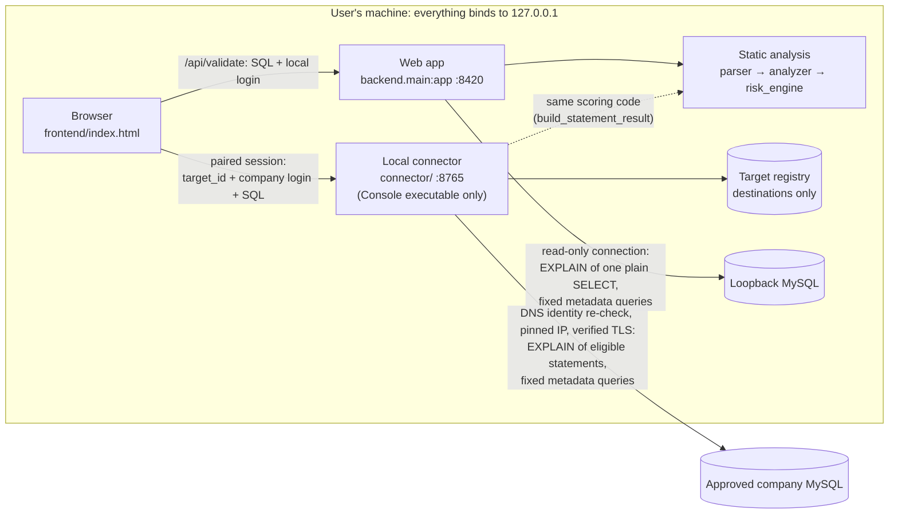

# Architecture

This document describes how MySQL DBA Validator is built today: its
components, how a validation request flows, what is sent to a database, how
scores are computed and what a result claims about database evidence. For the
security model and vulnerability reporting see [SECURITY.md](SECURITY.md); for
what has been tested see [VERIFICATION.md](VERIFICATION.md).

## Components

| Component | Code | Role |
| --- | --- | --- |
| Page | `frontend/index.html` | Single static page, no build step. Sends SQL to the web app, or to the connector for company targets. |
| Web app | `backend/main.py` (FastAPI) | Serves the page and `/api/*` on `127.0.0.1:8420`. Runs static analysis and local evidence. |
| Static analysis | `backend/parser.py`, `analyzer.py`, `risk_engine.py`, `evidence.py`, `recommendations.py`, `models.py` | Turns SQL into facts (SQLGlot, MySQL dialect) and applies explicit rules: score, findings, checklist, confidence. Needs no database. |
| Local evidence | `backend/db.py`, `db_evidence.py`, `metadata.py` | One read-only connection per validation to loopback MySQL, with the login supplied for that validation. |
| Evidence scoring | `backend/evidence_scoring.py`, `metadata_scoring.py` (M1), `m2_scoring.py` (M2) | Small, bounded adjustments to the static score from collected evidence. |
| Evidence state | `backend/evidence_state.py` | Builds each statement's `evidence` object from what the collectors returned. Pure result assembly: no database access. |
| Local connector | `connector/` (`launcher.py`, `server.py`, `policy.py`, `registry_store.py`) | Separate service on `127.0.0.1:8765` for operator-approved company targets. See [connector/README.md](connector/README.md). |
| Windows launcher | `release/launcher.py`, `release/mysql-dba-validator.spec` | Starts the packaged web app (and, in the Console executable, the connector). |

The parser produces facts; it does not decide anything about safety. Safety
decisions about what may be sent to a database are made in the evidence
collectors, on the exact text that would be sent.

## Local validation flow

1. The page posts SQL (up to 64 KiB, up to 16 statements) to `/api/validate`,
   optionally with a MySQL login and a selected database.
2. The backend classifies the target from its host and port. Only loopback
   MySQL on port 3306 is local. The request's deprecated `mode` field does not
   take part in that decision. A remote host is never connected to from here:
   the web app answers `delegated_to_connector` for an approved company target
   and `permission_denied` otherwise, and refuses company credentials.
3. Every statement is parsed, analysed and scored statically.
4. If a login and database were supplied, one evidence connection is opened
   with that login and bound to that database. Its session is set to read-only
   transactions first; if that fails, the connection is closed and no evidence
   is collected.
5. For each statement the collectors run (see the rules below), the scoring
   adjustments are applied, and the evidence state is built.
6. The connection is closed and the batch result is returned. The overall
   score is the highest statement score, not a sum.

Without a login and database, the result is static analysis only and says so.

## Remote validation flow

The remote path exists so company credentials and company network access
stay on the user's machine, under an operator's explicit approval, instead of
passing through a web API.

1. An operator starts `MySQL-DBA-Validator Console.exe` (or
   `python -m connector`). Targets are registered and approved by typing
   commands in its console, or requested from the page and approved with a
   code shown in that console (step 3). Approval snapshots the host's DNS
   identity. Browser sessions cannot approve, revoke or delete targets. The
   connector's target-management HTTP routes require an operator-scoped
   session, and the packaged launcher issues only browser-scoped pairing
   sessions, so in the packaged app target management is done in the
   connector console.
2. The page pairs with the connector using a single-use, five-minute code
   printed in that console. The resulting browser session lives in memory and
   may call only a fixed list of routes.
3. The page lists approved targets and refers to one by `target_id`; it cannot
   supply a host, port, IP or TLS setting for an operation. It may *request* a
   new target: a name, DNS host name, port and trust choice, plus an optional
   public CA bundle (no login, no SQL, no IP literal). The request opens no
   connection: the connector resolves the name and prints the request, its
   addresses and a one-time code in its console. Only that code, entered in
   the same paired session within five minutes, approves it, and only if the
   name still resolves to the addresses shown.
4. Database discovery and validation each send the user's MySQL login in the
   request body. For every connection the connector re-resolves the target,
   requires the address set to match the approved snapshot, connects to the
   validated IP, and requires TLS with certificate and host-name verification
   against that target's trust source: the configured CA (`--tls-ca`), its
   uploaded CA bundle (checked by SHA-256 on every connection), or the Windows
   certificate store (Windows only; refused elsewhere). A missing, changed or
   unknown trust source fails the operation before any TCP connection is
   opened. There is no fallback to another trust source or to plaintext.
5. A discovered database list is stored per target and browser session, bound
   to a keyed fingerprint of the MySQL username. Validation against a database
   requires it to be in that list. This binding is not authorization: MySQL
   still decides what the login may do.
6. The connector runs the same scoring and result assembly as the web app
   (`backend.main.build_statement_result` and `batch_result`), so local and
   remote results have the same shape and meaning.

## What may be sent to a database

The validator never executes submitted SQL, never runs `EXPLAIN ANALYZE`,
and has no endpoint that runs user-supplied SQL (`/api/evidence` returns
`evidence_queries_disabled`). Evidence queries are built by the application.

| | Local evidence (web app) | Remote evidence (connector) |
| --- | --- | --- |
| Connection | One per validation, login from the request | One per operation, login from the request, approved target only, pinned IP, verified TLS |
| Read-only session | `SET SESSION TRANSACTION READ ONLY`, then `SELECT @@SESSION.transaction_read_only` must return 1, or the connection is closed and no evidence is collected. Read back again on the same cursor before each plan request; if it is no longer 1, nothing is sent, the connection is closed and the rest of the batch gets no evidence | The same, for every company connection |
| `SELECT` plan | `EXPLAIN` only when the exact outgoing text is one plain `SELECT` with no `INTO`, no locking clause and no unqualified `DUAL` (regenerated as a quoted table name), and every word before `(` in the submitted and the outgoing text is on the reviewed list of MySQL 8.4 built-ins and reserved syntax words (`PERMITTED_CALL_NAMES`); quoted and schema-qualified calls are refused | The same |
| `UPDATE` / `DELETE` plan | Never requested (`plan_not_collected_read_only`) | Never requested (`plan_not_collected_read_only`) |
| `SELECT … INTO`, a `SELECT` the parser could only read permissively, or one calling a name outside the reviewed list | Not eligible (`plan_not_eligible`), nothing sent; the collector checks this itself, not only its callers | The same |
| Other statements | No plan | No plan |
| Metadata | Fixed, parameterised `information_schema` queries for the referenced tables | The same queries, only for the selected discovered database |
| Other | `SELECT DATABASE()` after a plan | `SELECT DATABASE()` after a plan; fixed, capped `SHOW DATABASES` for discovery |

MySQL error 1792 (read-only transaction) on the local connection is reported,
never retried. The web app's separate connection-test and database-discovery
endpoints accept only a loopback MySQL host: the test only opens and closes a
connection, and discovery runs a capped `SHOW DATABASES`.

MySQL account privileges are the authorization boundary: `EXPLAIN` needs the
same privileges as the statement it explains. The application's restrictions
are a safety layer on top of them. `EXPLAIN` can evaluate functions while
planning, so the function list is the first control; the read-only session is
the second. A read-only transaction prohibits changes to tables (temporary
tables excepted) but does not stop a function from sleeping or taking locks,
and it is not a privilege. Neither control has been tested against a real
server for stored-function behaviour. Because write plans are never requested,
the evidence account never needs `UPDATE` or `DELETE`. Until v0.4.1 the company
connection had no read-only session and requested `UPDATE`/`DELETE` plans;
v0.5.0 no longer does (see
[docs/v2-database-evidence-contract.md](docs/v2-database-evidence-contract.md)).

## Risk scoring

- **Deterministic first.** Findings and scores come from parser facts and
  explicit rules. No LLM makes risk or security decisions.
- **Risk levels.** Scores run from 0 to 100: `LOW` below 20, `MEDIUM` from 20,
  `HIGH` from 50, `CRITICAL` from 80.
- **Severity is not certainty.** An `UPDATE` with a real `WHERE` clause is
  reported with explicit row-impact uncertainty instead of an invented number.
- **`LIMIT` is not a universal safety rule.** Missing `LIMIT` on a write is not
  penalised by itself.
- **MySQL transaction semantics.** Transaction advice is scoped to DML,
  because many MySQL DDL statements commit implicitly.
- **An always-true `WHERE` is no `WHERE`.** A predicate that is true for
  every row by its structure (`WHERE 1`, `WHERE TRUE`, `WHERE 1 = 1`,
  `WHERE id = 5 OR 1`, `NOT FALSE`) is decided from the parse tree, never
  from text, and is scored, scoped and described exactly like a write with no
  `WHERE`: `CRITICAL`, `all_rows`. Words and string literals such as
  `'untrue'` are never read as Boolean constants. `WHERE id > 0` remains a
  "broad" heuristic (+25) unless an `AND` narrows it.
- **A `WHERE` clause is not evidence of a narrow write.** Every other
  `UPDATE`/`DELETE` with a `WHERE` gets
  +5 ("affected-row count cannot be established") and a `MEDIUM` floor.
  Column names such as `id` or `*_id` and an `=` in the predicate earn no
  reduction (v0.4.1 and earlier gave −5 for them).
- **Row scope** (`scope.basis`): `all_rows` for a single-table write with no
  partition selection, no `LIMIT`, and no `WHERE` or an always-true one (from
  the SQL); `at_most_one_row` only when table
  metadata confirms a primary key or unique index whose every column the
  `WHERE` fixes, through top-level `AND` terms, to a non-NULL literal of a
  compatible type, on a single-table write; `not_established` otherwise;
  `not_applicable` for statements that do not change existing rows. A
  verified `at_most_one_row` replaces the +5 and credits −5 (−10 in total): it
  is the only rule that lowers a score. It is a bound, not a count: the row
  may not exist. Every scope describes the target table's directly matched
  rows only: triggers, foreign-key actions (`ON DELETE`/`ON UPDATE CASCADE`,
  `SET NULL`) and other indirect effects are never inspected, and the result
  says so (`scope.indirect_effects: not_checked`, the scope reason, the page's
  scope line). A verified key therefore never makes the `v2_assessment` Data
  Risk dimension `LOW`, and the −10 credit never takes the score below 20:
  a verified one-row `UPDATE`/`DELETE` is at least `MEDIUM` overall, with
  the reason "MEDIUM is the minimum overall risk…". The verified scope and
  its `HIGH` confidence are still reported; `scope.factor.points` is the
  change actually applied and `scope.factor.medium_floor_applied` says
  whether the floor limited it.
- **`EXPLAIN` / `DESCRIBE` of a change.** The validator never sends these to
  MySQL; it scores what MySQL would do with the text. `EXPLAIN ANALYZE` runs
  the explained statement to time it, so it is scored as that statement
  (`EXPLAIN ANALYZE DELETE FROM t` is `CRITICAL`); when the explained
  statement cannot be read it is `HIGH` with `LOW` confidence. Plain
  `EXPLAIN`/`DESCRIBE` of an `UPDATE`, `DELETE`, `INSERT` or `REPLACE` plans
  it without running it, but gets +5 and a `MEDIUM` level with a finding
  that the text contains a data-changing statement. `statement_type` stays
  `DESCRIBE`.
- **Bounded `EXPLAIN` adjustments** (only for a collected one-row plan, for
  `UPDATE`/`DELETE` and, since v0.5.0, for a `SELECT`; with `LIMIT`, the
  row-estimate rule only when the plan shows `Using filesort` or `Using temporary`;
  never for a statement already `CRITICAL`):
  - +10 when `EXPLAIN` indicates a full table scan;
  - +10 when the optimizer estimates at least 10,000 rows.

  No access type lowers a score (v0.4.1 and earlier gave −3 for
  `const`/`eq_ref`/`ref`; `ref` is a non-unique lookup). `estimated_rows` is
  an optimizer estimate of rows examined, not an affected-row count. Because
  `UPDATE`/`DELETE` plans are not collected, in practice these adjustments
  apply to `SELECT` plans only.
- **Metadata adjustments**, each +5 and each requiring an `UPDATE`/`DELETE`
  with a `WHERE` clause, a collected plan showing a full table scan, available
  metadata, and a statement that is not already `CRITICAL`:
  - **M1** — exactly one matched table, complete metadata,
    `information_schema` `TABLE_ROWS` of at least 100,000, and the
    high-estimated-rows adjustment not applied (the optimizer estimated fewer
    than 10,000 rows for a large table).
  - **M2** — one table, a direct `column = literal` predicate on it, and
    index statistics showing no index whose leading column is that column.
    Since v0.5.0 it also applies to a `SELECT`; the page calls it
    "Filter and index assessment".

  M1 depends on a collected `UPDATE`/`DELETE` plan, which is not requested, so
  in practice it does not arise.
- **Missing evidence never lowers a score.** Every adjustment is a no-op
  without the evidence it needs, and `CRITICAL` is never reduced.
- **Confidence is about the assessment, not the evidence.** `confidence` is
  `HIGH`, `LIMITED` or `LOW` and is independent of risk: a `DROP TABLE` is
  `CRITICAL` with `HIGH` confidence. `HIGH` for DDL, DCL, transaction control,
  `SELECT`, and writes whose row scope is established (`all_rows`, or
  `at_most_one_row` from table metadata); `LIMITED` for other writes,
  `INSERT`, `REPLACE`, `CALL`, and a `SELECT` with a locking clause or a call
  outside the reviewed function list (also `MEDIUM` at least), in any query
  block of a set operation too, and a plain `EXPLAIN` of a `SELECT` with such
  a call (not for its locking clause: `EXPLAIN` takes no locks); `LOW` when the SQL could not be parsed (a
  statement the parser cannot read in full is not analysed). A referenced table that
  metadata did not find caps it at `LIMITED`. Missing or failed evidence never
  raises it. Batch `overall_confidence` is the lowest statement confidence.
  Computed in one place (`risk_engine.static_confidence`, capped in
  `main.final_confidence`).

## Evidence model

Each statement result has an `evidence` object, the source of truth for what
evidence it has. It is built once, in `backend/evidence_state.py`, and
everything else that talks about evidence is derived from it.

| Field | Values |
| --- | --- |
| `connection.state` | `not_attempted`, `connected`, `failed` (with a `reason` such as `auth_failed` or `unreachable`) |
| `plan.state` | `collected` (with `rows`, the number of `EXPLAIN` rows, and `interpreted`, true only for a one-row plan; a multi-row plan has `reason: multi_row_plan` and is shown, not scored), `not_collected_read_only` (every `UPDATE`/`DELETE`), `not_eligible` (a `SELECT` that is not one plain `SELECT`), `not_supported` (no plan for this statement), `failed`, `not_attempted` |
| `metadata.state` | `collected` (with `tables: [{name, found}]`), `failed` (with a `reason` such as `timeout` or `permission_denied`), `not_applicable` (no table), `not_attempted` |
| `overall` | `static_only`, `collected`, `partial` (some evidence collected, some failed), `unavailable` (nothing collected: the connection failed, or it succeeded but every requested evidence failed), `not_applicable` |

`collected` means MySQL returned that evidence, not that it is complete:
execution-plan rows and table rows are estimates, and `found: false` means
`information_schema.TABLES` returned no row for that name in the schema it was
looked up in (the selected database unless the SQL names another). The
`tables` names are the parser's physical table references: aliases and CTE
names are excluded (they were included in v0.4.1 and earlier). A table that
exists only as a temporary table can still be reported as not found.

The batch response's `evidence_summary` counts these states across all
statements and sets `partial` when some evidence was collected and some
failed. `analysis_mode` remains as a compatibility label derived from these
states: `DATABASE_EVIDENCE` means at least one plan was collected, not that
all evidence was; `STATIC_DATABASE_UNAVAILABLE`, shown as "Static + database
evidence unavailable", does not by itself mean the connection failed
(`connection.state` says that). Local and remote results use the same states
with the same meaning; only how evidence is collected differs.

Each statement result also carries (since v0.5.0):

| Field | Meaning |
| --- | --- |
| `scope` | `{basis, source, table, index, columns, factor}`: what is established about the rows an `UPDATE`/`DELETE` matches (see Risk scoring). `source` is `sql` for `all_rows`, `table_metadata` for `at_most_one_row`, otherwise `null`; `factor` is the score credit, if any |
| `confidence` / `static_confidence` | The final and the SQL-only confidence |
| `analysis_text_differs` | Kept for compatibility and now always `false`: a statement the parser cannot read in full is not analysed (`analysis_status` `unreadable` or `invalid`) rather than scored from a partial reading |
| `optimization` | Advisory observations from the SQL alone (`backend.optimization`), computed after the result is final; they never change it. See [evidence contract §10.6](docs/v2-database-evidence-contract.md) |
| `sql` | The statement exactly as submitted, without comments before or after it (one exception: [evidence contract §10.6](docs/v2-database-evidence-contract.md)). An analysed statement is analysed, and any `EXPLAIN` is built, from the parser's regeneration of it (`parser.StatementFacts.raw_sql`), which is not shown |
| `v2_assessment` | Its `overall_score`, `risk_level` and `confidence` equal the statement's (they were placeholders, `0` / `UNKNOWN`, in v0.4.1 and earlier); its suggested checks are guidance, never SQL built from the submitted text |

The batch adds `overall_confidence`, the lowest statement confidence (`null`
for an empty batch).

## Credentials and stored data

- MySQL logins are typed in the page and sent in the body of each operation.
  They are used for that operation only and are not written to disk, the
  target registry, logs, URLs or browser storage. There is no credential
  vault. (Python cannot guarantee that memory is wiped.)
- Company logins go only to the connector; the web app refuses them.
- The page stores only its theme choice and, when an update notice is
  dismissed, that release's version number in browser storage.
- Per-user data lives in `%LOCALAPPDATA%\MySQLDBAValidator\`: the connector's
  target registry (destinations and approval state, never credentials) and
  `logs\backend.log`. The program folder is never written to.

## Update notice

`backend/update_check.py`, reached only through `POST /api/update-status`
from the server's own loopback page, asks GitHub's REST API for the latest
published release at most once per process and keeps the answer in memory.
One fixed `GET` with no body and fixed headers, a 5 s timeout, verified TLS
and no redirects. A release is reported only when its tag is a strict
`vX.Y.Z`, numerically newer than `backend/version.py`, and its page is
exactly the official release page for that tag; every failure is
`unavailable`, shown as nothing. It never downloads or installs anything.
`MDV_UPDATE_CHECK=off` disables it. Details: [SECURITY.md](SECURITY.md).

## Packaged application

The Windows release contains two executables built from the same code:

- `MySQL-DBA-Validator.exe` runs the web app only, with no console window. It
  opens the page in the default browser and stops on its own about 15 minutes
  after the last page closed (the page sends a heartbeat while open). The
  backend runs in a Windows Job Object, so it stops if the launcher is killed.
- `MySQL-DBA-Validator Console.exe` runs the same web app plus the local
  connector. Its console window is the connector's operator console.

Build, audit and release steps are in [RELEASING.md](RELEASING.md).

## Deliberately not in the architecture

- No endpoint that executes submitted SQL, and no generic query endpoint.
- No automatic update: the update notice only links to the release page.
- No writable local evidence connection and no switch to enable one.
- No credential storage of any kind.
- No path from the browser to a company database that bypasses the connector.
- No user authentication: the tool is for one user on their own machine, or a
  trusted self-hosted setup (see "Running beyond one machine" in the
  [README](README.md#running-beyond-one-machine)).
