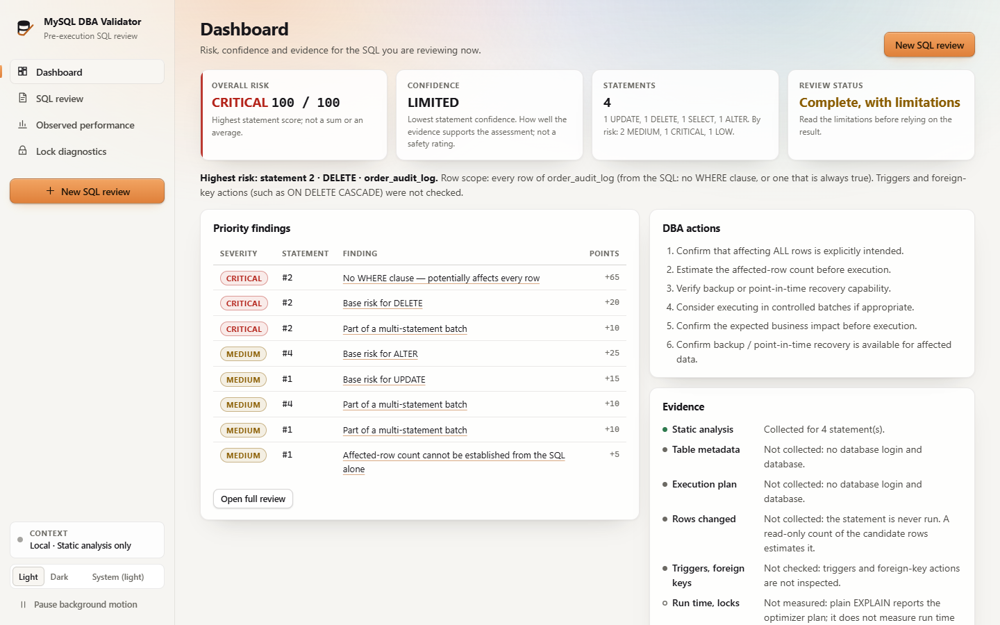

# MySQL DBA Validator

**How risky is this SQL, and how sure are we about that?**

MySQL DBA Validator helps DBAs review MySQL SQL from tickets before it is run. Paste up to 16 statements to get deterministic risk scores, confidence, findings and a review checklist. Optionally, collect limited read-only evidence from a database.

It supports DBA judgement; it does **not** guarantee that SQL is safe.

**Current release: [v0.12.0](https://github.com/realspinn/mysql-dba-validator/releases/tag/v0.12.0)** · Pre-1.0 · Windows x64 installer and portable ZIP, and unsigned macOS Apple Silicon builds.


*SQL review: paste the SQL, review it, and read the result next to it.*



*Dashboard: the same review at a glance.*

Both screenshots show made-up SQL reviewed with static analysis only, without a database login.

## What it does

- **Risk:** classifies and scores each statement using explicit rules. A batch takes the highest statement score; scores are not added together.
- **Confidence:** reported separately as `HIGH`, `LIMITED` or `LOW`. It describes how well the available evidence supports the assessment, not whether the SQL is safe.
- **Findings:** explains score reasons, known write scope, unknowns and DBA checks.
- **Database evidence (optional):** collects limited evidence such as an eligible plain-`SELECT` execution plan and table metadata. Results distinguish collected, unavailable and failed evidence.
- **Optimization advice:** flags selected SQL patterns using fixed advisory rules. It does not rewrite SQL, change risk scores or measure performance.
- **Observed performance (optional):** on request, reads the statement families MySQL has already recorded for one schema in Performance Schema. It does not measure the SQL in your review and never changes a result. See [docs/historical-schema-workload.md](docs/historical-schema-workload.md).
- **Lock diagnostics (optional):** on request, shows current InnoDB row lock waits in one schema: the waiting and blocking sessions, table, index and lock modes. Nothing is killed, committed or rolled back. See [docs/innodb-lock-waits.md](docs/innodb-lock-waits.md).
- **No submitted SQL execution:** the validator never executes the SQL being reviewed. Risk decisions are deterministic; no AI or LLM makes them.

## Important limitations

- Risk and confidence are assessments, not guarantees. Review the SQL yourself before running it.
- SQL the parser cannot fully read is reported as **not analysed**, not treated as low risk. Some valid MySQL syntax is unsupported; see the [evidence contract](docs/v2-database-evidence-contract.md).
- A `SELECT` can still have effects, for example through locking clauses or functions. The validator applies restrictions, but cannot establish what an arbitrary stored function does.
- Optimization advice identifies patterns in SQL text. It cannot see the data, indexes or column types, and does not prove that a suggested change is equivalent or faster.
- **Live validation is limited.** The v0.8.0 adviser rules and `FROM DUAL` handling have not been checked against a real MySQL server. The Host check is covered by automated tests. Observed performance and lock diagnostics were checked against a disposable MySQL 8.4 server in CI only. Company infrastructure, VPN and company TLS are not verified. See [VERIFICATION.md](VERIFICATION.md).
- The Windows build is not code-signed. The macOS build is ad hoc signed, not notarized, and has not been tested on a real Mac.
- The in-app update download (Windows) is covered by automated tests, and a packaged v0.10.1 downloaded and verified the published v0.11.0 release. It never installs anything: you extract the ZIP yourself.
- The app is designed for one user on one machine; it has no user authentication.

## Download and run

Get the ZIP and its matching `.sha256` file from the [v0.12.0 release page](https://github.com/realspinn/mysql-dba-validator/releases/tag/v0.12.0). Verify the checksum before running the application.

**Windows x64** has two downloads. Both run the same application, locally in your browser. Python is not needed, and MySQL is optional (static analysis works without it).

- **Installer** (`MySQL-DBA-Validator-v<version>-windows-x64-setup.exe`) for a normal Windows installation. It installs for your user only, without administrator rights, into `%LOCALAPPDATA%\Programs\MySQL DBA Validator`, and adds Start menu shortcuts (the application, and the Console edition for company targets) and an optional desktop shortcut. It does not start with Windows or add a service. The installer is not in v0.11.0; it comes with the first release that lists a `-setup.exe` file.
- **Portable ZIP** (`MySQL-DBA-Validator-v<version>-windows-x64.zip`) if you prefer to extract and run it, or cannot install software.

Verify either file before running it (PowerShell), and compare with the `.sha256` file or the value on the release page:

```powershell
Get-FileHash .\<file name> -Algorithm SHA256
```

*Installer:* run the setup file, choose a folder if you want a different one, and finish. Start **MySQL DBA Validator** from the Start menu; your browser opens `http://127.0.0.1:8420`. The app keeps running after you close the page and stops about 15 minutes later (the Console edition stops when you close its window). To upgrade, download the newer setup file, close the app, and run it: it upgrades the same installation. Setup will not close a running copy for you and will not replace a newer version with an older one. To uninstall, use Windows **Settings > Apps > Installed apps**. Uninstalling keeps your data in `%LOCALAPPDATA%\MySQLDBAValidator` (approved targets, your `.env`, trust files, logs); delete that folder yourself if you want it gone.

*Portable ZIP:* extract it and run `MySQL-DBA-Validator.exe`. Your browser opens `http://127.0.0.1:8420`.

For approved company targets, run the Console edition (`MySQL-DBA-Validator Console.exe`, or the **Console (company connector)** Start menu shortcut) instead; it provides the local connector's operator console. Company access still needs the connector's pairing and target approval, unchanged. See [connector/README.md](connector/README.md).

Neither Windows download is code-signed, so Windows SmartScreen may warn about them. That is a limit of these releases, not a sign the file is safe or unsafe: check the checksum, and do not turn off Windows security features to get past it.

**macOS (Apple Silicon only)**

Download `MySQL-DBA-Validator-v0.12.0-macos-arm64-unsigned.zip`, verify it with its checksum file, then follow the opening instructions in the [release notes](https://github.com/realspinn/mysql-dba-validator/releases/tag/v0.12.0). The app is not notarized.

**Updates:** the app can check GitHub for a newer release at startup and show a dismissible notice. On Windows, **Update** downloads the new release ZIP and verifies it (size, SHA-256 digest from GitHub, archive contents); you then close the app, extract the ZIP and open the new folder. It never installs or runs anything itself. An installed copy does not offer the ZIP: its notice links to the release page, where you download the setup file. On macOS the notice links to the release file for your browser to download. v0.7.0 and v0.8.0 show the notice with a link to the release page only: install the newer version by hand once (saved targets, the `.env` file and the theme are kept), and from then on the Windows **Update** and the macOS **Download** link work as above. GitHub receives your IP address and the installed version; no SQL, login or connection details are sent. Set `MDV_UPDATE_CHECK=off` to disable the check. Details: [SECURITY.md](SECURITY.md#security-model-in-brief).

## Quick start

1. Open the app and paste the SQL from the ticket.
2. Choose **Validate SQL**.
3. Review the risk and confidence, then inspect each statement's findings, evidence and checklist.
4. Verify the change independently before running it.

Without a database login, analysis is based on SQL text only. Optional database evidence uses read-only connections. Company databases are accessed through the local connector and operator-approved targets; see [connector/README.md](connector/README.md).

## Documentation

| Document | What it covers |
| --- | --- |
| [Architecture](ARCHITECTURE.md) | Components, request flows, scoring and evidence model |
| [Evidence contract](docs/v2-database-evidence-contract.md) | Result fields, evidence rules and known analysis limitations |
| [Security policy](SECURITY.md) | Security boundaries and private vulnerability reporting |
| [Verification](VERIFICATION.md) | What has and has not been tested |
| [Local connector](connector/README.md) | Company-target setup and operator console |
| [Hosted online demo](docs/public-demo.md) | The static-only public mode (`MDV_PUBLIC_DEMO=1`) and its deployment |
| [Contributing](CONTRIBUTING.md) | Development setup, tests and pull requests |
| [Releasing](RELEASING.md) | Maintainer release procedure |
| [GitHub Releases](https://github.com/realspinn/mysql-dba-validator/releases) | Downloads, release notes and checksums |

## Run from source

Requires Python 3.14. From the repository root:

```powershell
python -m venv .venv
.\.venv\Scripts\Activate.ps1
pip install -r requirements.txt
uvicorn backend.main:app --host 127.0.0.1 --port 8420
```

Open `http://127.0.0.1:8420`. Run the test suite with `python -m pytest -q` and check dependencies with `pip check`. More detail is in [CONTRIBUTING.md](CONTRIBUTING.md).

## Help and contributions

Report bugs and request features in [GitHub Issues](https://github.com/realspinn/mysql-dba-validator/issues). Use made-up SQL; never post credentials, company hostnames or customer data. Report security vulnerabilities privately using the process in [SECURITY.md](SECURITY.md).

## License

[MIT](LICENSE).
